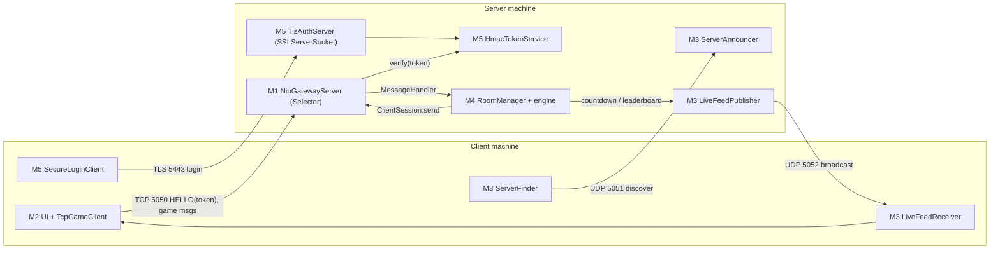
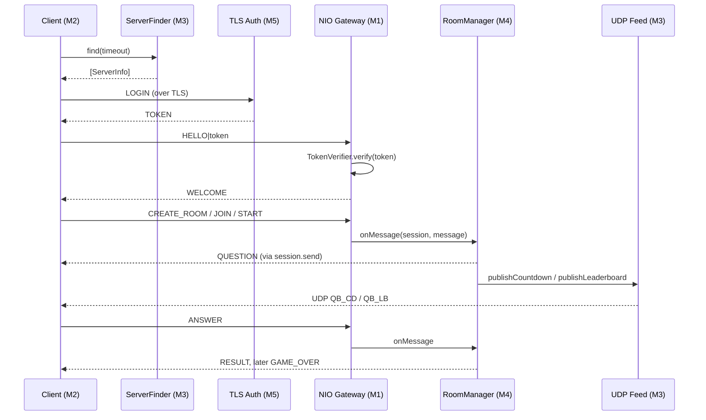

# Campus Quiz Battle - Architecture

A Kahoot-style multiplayer quiz game for a campus LAN. Players find a server, log in securely, join a room and answer timed questions while everyone sees a live countdown and leaderboard.

The design goal is **five independent modules, one network-programming concept each**, that only talk to each other through small interfaces in `common`. That is what lets five people work in five folders without touching each other's code.

## 1. System overview



## 2. Module responsibilities

| Module | Folder | Concept | Runs on | One-line job |
|---|---|---|---|---|
| M1 | `m1-nio-gateway` | Java NIO | server | One selector thread serves every game connection |
| M2 | `m2-tcp-client` | TCP sockets, protocol, addressing | client | Client app, UI and the wire protocol |
| M3 | `m3-udp-feed` | UDP | both | Server discovery and live countdown/leaderboard |
| M4 | `m4-game-core` | Multithreading | server | Rooms, rounds, timers, scoring |
| M5 | `m5-security` | Secure sockets (TLS) | both | TLS login, password hashing, signed tokens |
| shared | `common` | none | both | Message format and contracts |
| wiring | `app` | none | both | `ServerMain` and `ClientMain` |

## 3. Why each concept is used where it is

| Need | Choice | Reason |
|---|---|---|
| Serve many players on the game channel | **NIO selector** (TCP) | One thread, no thread per client; required by the assignment |
| Answers, joins, final results must not be lost | **TCP** | Reliable and ordered |
| Find servers without typing an IP | **UDP broadcast** | Connectionless, no server address is known yet |
| Live countdown / leaderboard | **UDP** | A lost tick is irrelevant because the next one replaces it |
| Several rooms with timers at once | **Thread pool + scheduler** | Round timers and answer handling run concurrently |
| Protect passwords on shared Wi-Fi | **TLS** (`SSLServerSocket`) | Stops eavesdropping and MITM; certificate proves the server |
| Prove a player logged in | **HMAC-signed token** | Tamper-evident, short lifetime, verified by the gateway without calling the auth server |

## 4. Main flow (sequence)



## 5. Threading model

| Thread(s) | Owner | Rule |
|---|---|---|
| 1 selector thread | M1 | Never calls game logic, never blocks, never does slow work |
| Handler pool (N threads, `ExecutorService`) | M4 creates, M1 uses | All `MessageHandler` callbacks run here |
| Scheduler (`ScheduledExecutorService`) | M4 | Round timers and per-second feed ticks |
| TLS acceptor + worker pool | M5 | One short task per login |
| UDP announcer thread, UDP feed receiver thread (daemon) | M3 | Block on `receive()`, exit on `close()` |
| Client: UI thread, TCP reader thread, UDP receiver thread | M2 / M3 | UI updates are marshalled to the UI thread |

Shared mutable state lives only in M4 (rooms, scores) and in M1's per-session write queues. Both must be thread-safe.

## 6. Integration contracts (frozen after Phase 0)

These signatures are the only coupling between modules. They live in `common` and are agreed on Day 1 (see plan.md, Part 0). Changing one needs all five members to approve.

```java
// package com.quizbattle.common   (the whole common module is ONE package)
public enum MessageType { /* every type in docs/PROTOCOL.md */ }
public record Message(MessageType type, List<String> fields) {}
public final class MessageCodec {
    public static String encode(Message m);                    // no trailing newline
    public static Message decode(String line) throws ProtocolException;
}

public record ServerInfo(String name, String host, int gatewayPort, int tlsPort) {}

public interface ClientSession {                    // implemented by M1
    String id();
    Optional<String> username();                    // empty until HELLO accepted
    SocketAddress remoteAddress();
    void send(Message message);                    // thread-safe, never blocks (enqueue)
    void close();
}

public interface MessageHandler {                   // implemented by M4, called by M1
    void onConnect(ClientSession session);
    void onMessage(ClientSession session, Message message);
    void onDisconnect(ClientSession session);
}

public interface TokenVerifier {                    // implemented by M5, called by M1
    Optional<String> verify(String token);          // username if valid and not expired
}

public interface SecureLoginClient {                // implemented by M5, called by M2
    void register(String host, int tlsPort, String username, char[] password) throws IOException;
    String login(String host, int tlsPort, String username, char[] password) throws IOException; // returns token
}

public interface LiveFeedPublisher extends AutoCloseable {          // implemented by M3, called by M4
    void publishCountdown(String roomId, int secondsLeft);
    void publishLeaderboard(String roomId, Map<String, Integer> scores);
}

public interface LiveFeedListener {                 // implemented by M2, called by M3
    void onCountdown(String roomId, int secondsLeft);
    void onLeaderboard(String roomId, Map<String, Integer> scores);
}

public interface LiveFeedReceiver extends AutoCloseable {           // implemented by M3, used by M2
    void start(LiveFeedListener listener) throws IOException;
}

public interface ServerAnnouncer extends AutoCloseable {            // implemented by M3, used by app
    void start(ServerInfo info) throws IOException;
}

public interface ServerFinder {                     // implemented by M3, used by M2
    List<ServerInfo> find(Duration timeout) throws IOException;
}
```

Public entry points (constructors the `app` module calls):

| Module | Class | Constructor / usage |
|---|---|---|
| M1 | `NioGatewayServer` | `new NioGatewayServer(int port, MessageHandler handler, TokenVerifier verifier, Executor handlerExecutor)`; `start()`, `stop()` |
| M2 | `TcpGameClient` | `new TcpGameClient(String host, int port, String token)`; `connect()`, command methods, `close()` |
| M3 | `UdpServerAnnouncer`, `UdpServerFinder`, `UdpLiveFeedPublisher`, `UdpLiveFeedReceiver` | built from `AppConfig` |
| M4 | `RoomManager` | `new RoomManager(AppConfig, LiveFeedPublisher)`; `executor()` exposes the handler pool for M1 |
| M5 | `TlsAuthServer`, `TlsSecureLoginClient`, `HmacTokenService` | built from `AppConfig`; `HmacTokenService` implements `TokenVerifier`; `TlsAuthServer.start()/stop()` |

## 7. Security design

| Threat (from the lectures) | Defence | Owner |
|---|---|---|
| Eavesdropping on passwords | Login only over TLS | M5 |
| Spoofing / fake "University Free WiFi" server | Client trusts only the server certificate in its truststore, hostname verification on | M5 |
| Man-in-the-middle | TLS certificate validation; a MITM without the key fails the handshake | M5 |
| Data tampering (token) | HMAC-SHA256 signature checked with constant-time compare | M5 |
| Replay of a captured token | Short token lifetime (expiry inside the signed data) | M5 |
| Denial of service | Read timeouts, max line length, login lockout, write-queue cap, idle disconnect | M5 + M1 |
| Hard-coded secrets | Keystore password and token key come from environment variables, keystores are git-ignored | M5 |

**Known trade-off:** game messages on port 5050 are not encrypted. Wrapping a non-blocking NIO channel with `SSLEngine` is complex, so the design protects the *credentials* (TLS) and the *session* (signed token). This is stated openly in the report. A stretch goal for M1 + M5 is `SSLEngine` on the gateway.

## 8. Configuration

All ports and options live in `config/server.properties` and `config/client.properties`. Secrets come only from environment variables: `QB_KEYSTORE_PASSWORD`, `QB_TOKEN_SECRET`.

## 9. Repository layout

```
campus-quiz-battle/
├── README.md  architecture.md  plan.md  pom.xml
├── .gitignore  .gitattributes  .editorconfig
├── .github/            CODEOWNERS, pull_request_template.md
├── config/             server.properties, client.properties
├── scripts/            keystore + run scripts (.sh and .bat)
├── secrets/            (git-ignored) keystore, truststore, user store
├── docs/               PROTOCOL.md, report-outline.md, report/ (final PDF)
├── common/             shared contracts      (all, via approved PRs)
├── m1-nio-gateway/     Member 1
├── m2-tcp-client/      Member 2
├── m3-udp-feed/        Member 3
├── m4-game-core/       Member 4
├── m5-security/        Member 5
└── app/                ServerMain / ClientMain wiring (integration only)
```

## 10. Risks and assumptions

| Risk | Mitigation |
|---|---|
| Campus Wi-Fi blocks UDP broadcast or isolates clients | Multicast mode (`udp.feed.mode=multicast`), manual server IP entry in the client, phone hotspot for the demo |
| Windows firewall blocks ports 5050/5051/5052/5443 | Allow Java through the firewall; add the ports to the setup checklist |
| Self-signed certificate hostname mismatch on the LAN | Generate the keystore with `QB_EXTRA_SAN=ip:<server LAN IP>`; distribute `truststore.p12` to clients |
| One member falls behind | Every module is testable alone with mocks; core tasks are small and listed first in plan.md |
| Merge conflicts | One folder per person; `common/` frozen after Phase 0 |

Non-goals: persistence of game history, internet deployment, anti-cheat.
