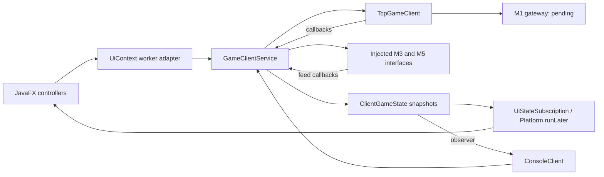

# Campus Quiz Battle - M2 TCP client

M2 provides the persistent TCP game client, immutable client state, asynchronous
application service, console interface and interactive JavaFX application. The
available M2 implementation is complete and ready for review and demonstration.
**Full real multiplayer integration remains pending:** fetched develop `a5bd2e6`
still has skeleton M1, M3 and app implementations.

The client follows the shared protocol and keeps the server authoritative for
membership, answer acceptance, deadlines, scores, round transitions and winners.
No UDP/TLS socket implementation, game engine, database or automatic session
restoration is added to M2.

## Documentation

| Document | Purpose |
|---|---|
| [REPORT.md](REPORT.md) | Academic report material; five implementation-based Mermaid diagrams |
| [DEMO_GUIDE.md](DEMO_GUIDE.md) | Complete mock/TLS/console demonstration and an eight-minute presentation flow |
| [INTEGRATION.md](INTEGRATION.md) | Verified constructors, real provider wiring, ports/certificates, limitations and pending three-client LAN procedure |
| [SUBMISSION.md](SUBMISSION.md) | Submission contents, exclusions and authorized Git integration record |
| [FINAL_INTEGRATION.md](FINAL_INTEGRATION.md) | Current integration results, owner blockers and publication status |

## Technology and module structure

Java 17 release compilation, Maven 3.9+, JUnit 5 and JavaFX **17.0.18** are used.
Local execution used Microsoft OpenJDK 21.0.8. Actual Java 17 runtime testing remains
pending; no JDK was installed and no system Java configuration was changed.

JavaFX controls/FXML dependencies are optional for M2 consumers. The networking,
state, service and console contain no JavaFX imports. Maven Dependency Plugin
3.6.1 prepares platform JavaFX jars under target/javafx for the local launcher.
**JavaFX still requires team approval before integration/merge.** Local development
authorization does not establish that approval. No unrelated libraries were added.

```text
m2-tcp-client/
  pom.xml
  README.md / INTEGRATION.md / REPORT.md / DEMO_GUIDE.md / SUBMISSION.md
  scripts/
    launch-gui.ps1
    verify-real-security.ps1
  examples/M5ManualProvider.java       Proposed app-owned code; not installed
  src/main/java/com/quizbattle/client/
    TcpGameClient.java / ProtocolLineReader.java
    ClientMessageListener.java / ClientTimeouts.java
    model/                           Reducer, snapshots and immutable records
    service/                         Async facade and sanitized auth failures
    ui/                              Console, JavaFX lifecycle, routes and helpers
      controller/                    FXML controllers
      components/                    Cards, timer, rankings, podium and branding
  src/main/resources/
    fxml/                            Actual screen layouts
    css/                             Theme, shared controls and gameplay
  src/test/java/com/quizbattle/client/
    *Test.java                       Headless JUnit tests
    Fake*.java / GuiMockScenario.java Explicit test services and TCP fixtures
    GuiSmokeLauncher.java             Graphical regression entry point
    MockGuiLauncher.java / MockQuizDemo.java
    RealSecurityProbe.java           Opt-in actual M5 verification
  docs/screenshots/                   Nine curated actual application captures
  target/                            Ignored build output; never stage it
```

Historical PlaceholderController/placeholder.fxml are preserved for compatibility;
no active Screen route uses them. The quiz, round-result and final-result routes
all load implemented controllers.

## Architecture and threading



One event executor serializes commands and incoming messages. Two I/O workers
handle discovery, supplied authentication calls and TCP setup. A dedicated TCP
reader decodes incoming lines and enqueues callbacks. Writes are synchronized.
DNS, TLS, connection work and cleanup do not run on the JavaFX thread.

Snapshots and their collections are immutable. Observers must be quick and must
never wait on service futures. The UI bridge coalesces adjacent informational
updates while retaining gameplay/error/navigation boundaries. Batches yield to
the FX thread; disposed views ignore callbacks and release animations/listeners.
The service event/I/O queues are not claimed to be globally bounded.

Registration completion is guarded by a request generation: an older success or
failure cannot replace the current session/newer request notice. Its own future
still reports the actual result. Cancelling a future does not undo a server action;
use disconnect/close to terminate a session. External TLS/DNS calls are subject to
the providers' own deadlines and cancellation support.

## TCP and gameplay behavior

TcpGameClient resolves the selected hostname/IP, connects with a timeout, sends
HELLO and waits for valid WELCOME before becoming authenticated. UTF-8 payloads
are bounded to 4096 bytes, LF-framed and processed through shared MessageCodec
with strict framing/escape checks. Fragmentation and persistent connections are
tested. Raw server payloads and credentials are not logged.

Commands remain HELLO, PING, LIST_ROOMS, CREATE_ROOM, JOIN, LEAVE, START and ANSWER.
Rooms wait for JOINED, games wait for QUESTION, and answers preserve the actual
wire question ID with zero-based choice indices. A displayed-Question overload
rechecks instance identity before sending, including reused-ID interactions.
Sending, sent, rejected and authoritative result states are distinct.

Own points come only from RESULT or final TCP standings. Incorrect answers can
still display nonzero server awards. GAME_OVER supplies the announced winner and
server listing order; no local tie-break is invented. Next rounds are triggered
only by server messages. Return to Lobby sends LEAVE and requests rooms without
inventing an acknowledgement. Room refresh has a bounded retryable reply wait.

The JavaFX journey covers welcome, discovery/manual selection, registration/login,
room browser/creation, host/guest waiting, four answer cards, submitted waiting,
round feedback and final podium/complete standings. WAITING_ROOM is the ready
state; there is no unsupported per-player READY message.

The countdown animates last-reported values and never decides acceptance, disables
answers at zero or advances a round. Live rankings show empty/stale status, sort
live ties deterministically and virtualize large lists. Final TCP data cannot be
overwritten by UDP. Wrong-room and old-session callbacks are ignored.

Mouse and keys **1?4** (also numpad) select answers. Tab/Space/Enter activate
controls, F11 toggles fullscreen and Esc exits it. Held keys stay latched across
rounds and dialogs. Long data wraps and scrolls; reduced motion stops/settles
visual effects. The scene starts at 1280x800 with a 960x640 minimum outer window.

## Build and tests

Run from the repository root:

```powershell
mvn -q -pl m2-tcp-client -am clean test
```

The standard reactor still fails the existing common
`MessageCodecTest.testDecodeComplexEscaping` (42 common tests; one failure), before
reaching M2. That shared code/test was not changed or disabled. Run all M2 cases
separately and report both results:

```powershell
mvn -q -pl m2-tcp-client -am clean test '-Dtest=com.quizbattle.client.**.*Test' '-Dsurefire.failIfNoSpecifiedTests=false'
```

| Final verification | Result |
|---|---|
| Existing M2 cases preserved | 273 |
| New final-QA regressions | 8 |
| Total ordinary M2 tests | **281 passed; 0 failures/errors/skips** |
| Graphical smoke | **308 checks passed** |
| Actual M5 TLS probe | **18 checks passed**, separate from mocks/JUnit |
| Standard reactor | Shared codec failure remains visible |
| Java compatibility | Release 17 bytecode (major 61), JavaFX 17.0.18; Java 21 execution |
| Real UDP/NIO-to-M4/physical LAN | Pending missing implementations/environment |
| Actual Java 17 runtime / manual OS input | Pending |

Ordinary tests are headless compatible and use controlled loopback fixtures,
OS-assigned ports and bounded waiting. The final eight cases cover delayed,
superseded/cancelled registration and consistent console address validation.

## Launch commands

```powershell
# Honest normal entry point: requires real app/provider wiring for networking.
& .\m2-tcp-client\scripts\launch-gui.ps1

# Complete three-question graphical fixture: real game TCP, fake other services.
& .\m2-tcp-client\scripts\launch-gui.ps1 -Mock

# Real JavaFX windows, deterministic event-based checks, screenshots; auto-exits.
& .\m2-tcp-client\scripts\launch-gui.ps1 -Smoke

# Actual fetched M5 TLS classes with ephemeral certificates; no branch integration.
& .\m2-tcp-client\scripts\verify-real-security.ps1
```

The GUI script builds with `-DskipTests package` to prepare the launch; this is
not acceptance-test evidence. Use -SkipBuild only with existing valid output.
An IDE can write incomplete executable error stubs into Maven's class directory;
the launcher detects/rebuilds those generated files. It never removes source.
If the IDE keeps interfering, pause automatic IDE compilation and rebuild.

Normal mode uses an optional GuiServiceProvider from ServiceLoader or
ClientApplication.launchInjected. With no real provider it displays SERVICES NOT
CONFIGURED and never silently uses mocks. App must supply M3/M5 jars and JavaFX
runtime dependencies; M2's launcher does not automatically add sibling modules.
See INTEGRATION.md and the compiled example for exact constructor requirements.

The independent console fixture uses two questions:

```powershell
java -cp 'm2-tcp-client/target/test-classes;m2-tcp-client/target/classes;common/target/classes' com.quizbattle.client.MockQuizDemo
```

Use colon classpath separators on Linux/macOS. Discover/select server 1, log in as
alice with a throwaway password, create Networks with two questions, wait for
JOINED, enter start, then answer q1 2 and answer q2 1 at their respective prompts.
The fixture ends with total 230, winner alice; choose 3 to exit. Authentication
waits allow the real TLS/TCP budget; ordinary console requests retain their shorter
wait. The complete graphical fixture and eight-minute flow are in DEMO_GUIDE.md.

## Configuration and security

Existing config/client.properties and AppConfig supply hostname, game/TLS ports,
UDP settings and the public server-certificate path. Defaults are 5050 TCP, 5443
TLS, 5051 discovery and 5052 feed; these are configurable ports, not fixed server
addresses. Manual selection remains available when discovery fails. Environment
variables map dots to underscores, e.g. QB_CLIENT_SERVER_HOST.

ClientTimeouts.fromConfig accepts optional client.connect.timeout.ms (3000),
client.authentication.timeout.ms (4000) and client.read.timeout.ms (0: persistent
idle read). These apply to game TCP; M5 owns its separate TLS deadlines. Invalid
host/port/timeout values fail safely. Both interfaces use the same syntactic manual
address validation; DNS happens on a worker.

The actual M5 probe preserves certificate trust and hostname verification. It
verifies registration/login, safe errors, token receipt/verifier checks, missing or
untrusted certificates, hostname mismatch and connection refusal. Its token handoff
uses a test TCP gateway, not actual M1. Temporary keys/source/classes/reports stay
under ignored target/real-m5. Never deploy or stage those keys.

M5-owner issues remain credential delimiter escaping, token-format discrepancies,
lockout/rate limiting and provider cancellation/worker cleanup. M2 keeps tokens
opaque, sanitizes failures and does not bypass security to work around those gaps.
Password arrays are cleared, but Java/JavaFX String copies cannot be overwritten.
The shared design encrypts credentials over TLS, not the game TCP channel.

## Screenshots, troubleshooting and submission

Nine selected **actual** mock-mode captures live in [docs/screenshots](docs/screenshots).
The index is in DEMO_GUIDE.md; the arena image also documents the leaderboard to
avoid redundant assets. Full current screenshots and the resolution matrix remain
ignored under target/gui-smoke. They exercise all screens at 1280x800, 960x640,
1366x768, 1920x1080 and fullscreen, including long data and 201-player standings.
JavaFX event-based checks are distinct from manual OS-level testing.

For failed discovery, use manual addressing. For refused/time-out connections,
check the chosen ports, server process and firewall. For certificate failures,
obtain the public certificate, check its path/fingerprint and hostname/IP SAN;
never disable verification. For rejected/expired tokens, log in again. After a
room refresh timeout, retry; after duplicate/late answers, wait for the server.
After connection loss, reconnect manually. Detailed troubleshooting is in
INTEGRATION.md.

Frozen limitations remain: no initial roster snapshot, no LEAVE acknowledgement,
no ERROR correlation ID, no question ID on UDP countdown, and ambiguity if wire
question IDs are reused. No unsupported messages or game rules were added.

[SUBMISSION.md](SUBMISSION.md) records the M2 checkpoint and merge of fetched
develop into the feature branch. [FINAL_INTEGRATION.md](FINAL_INTEGRATION.md)
records current checks and why merging back to develop is blocked. Do not include
target output, temporary TLS material, logs, IDE files or the full screenshot matrix.
