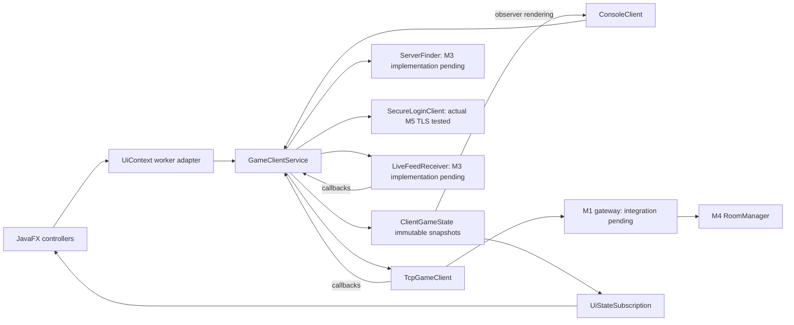
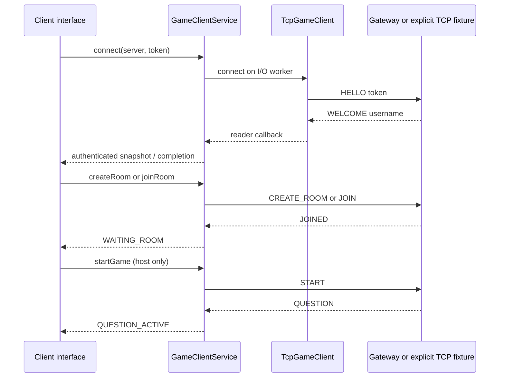
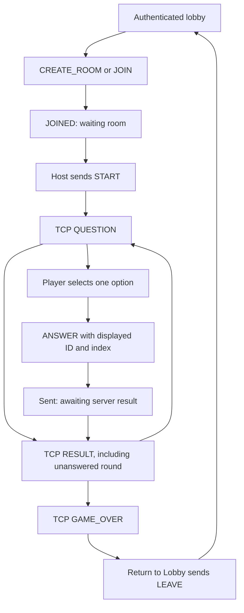
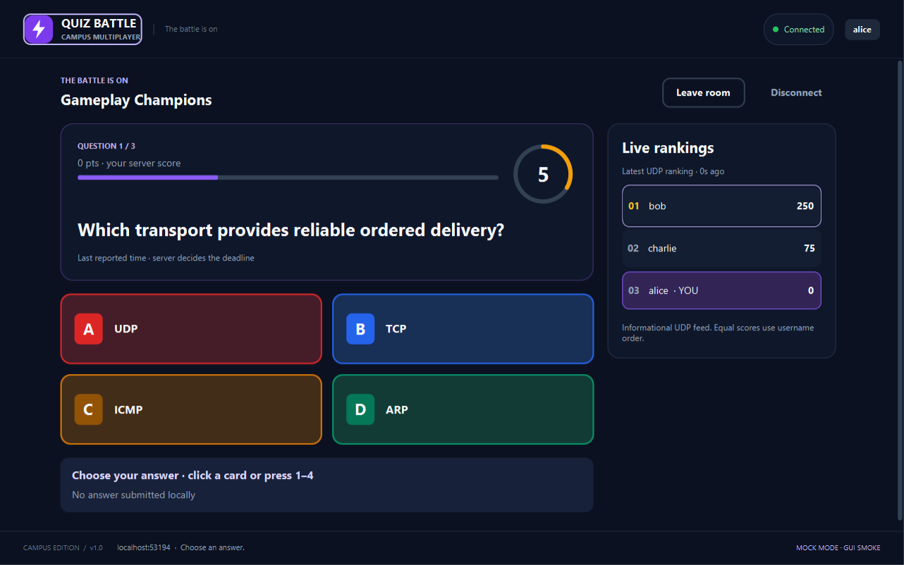
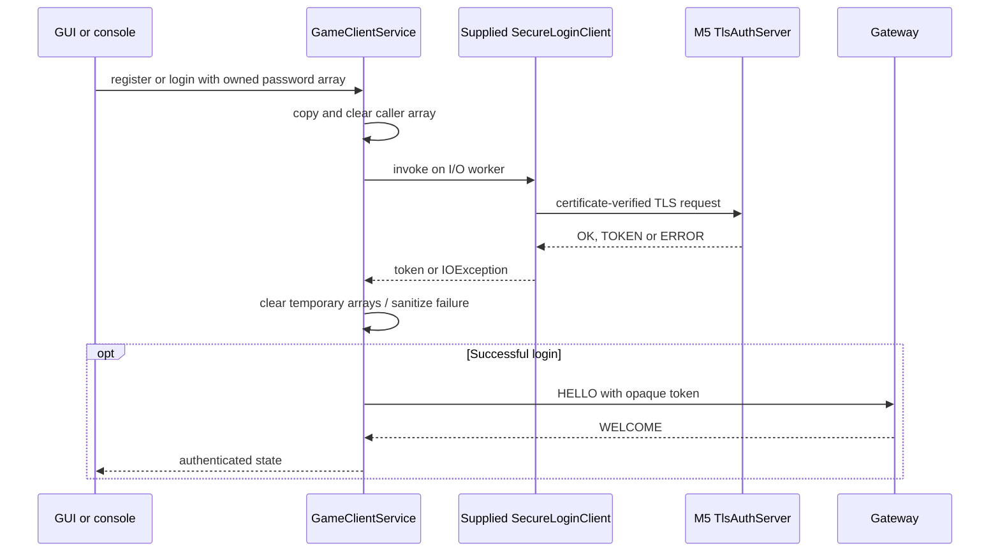
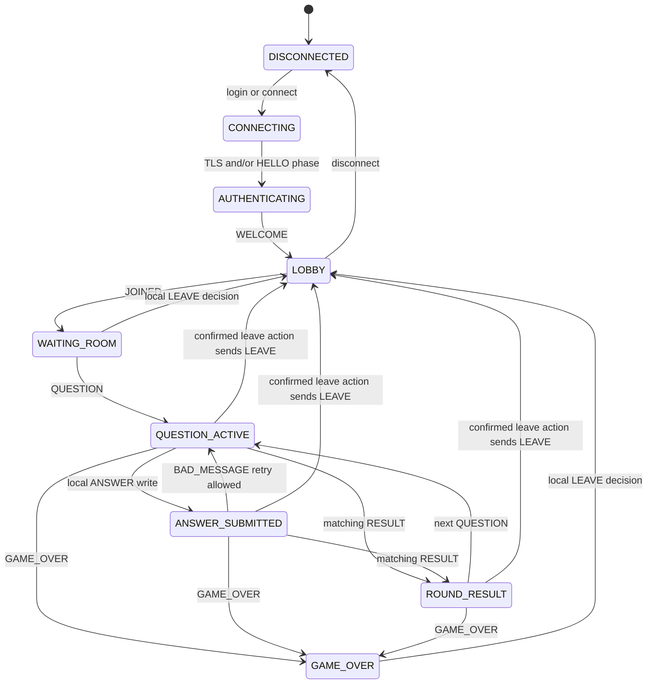

# Member 2 report: TCP client and protocol

## 1. Introduction

Campus Quiz Battle is a Java multiplayer quiz system designed for a campus local
area network. Member 2 implements the client side of its persistent TCP game
channel, the asynchronous application service, an independent console interface
and a JavaFX graphical interface. The client presents server data and submits
player commands; the server decides membership, deadlines, scoring and winners.

The completed M2 implementation supports the full quiz journey against an explicit
test server using actual loopback TCP. Actual M5 TLS authentication has also been
tested independently. These are distinct forms of evidence: real NIO/UDP and
three-machine multiplayer integration remain unavailable because M1, M3 and app
entry points are still skeletons at the fetched develop revision `a5bd2e6`.

## 2. Objectives

The objectives are to establish an authenticated persistent game connection,
implement the shared text protocol faithfully, present received game state
responsively, protect credentials through the supplied security interface, and
recover predictably from errors and connection loss. Java 17 compatibility and
clear module ownership allow M2 to integrate with the team's existing contracts.

## 3. Responsibilities and boundaries

M2 owns TcpGameClient, bounded line reading, command validation, observable client
state, asynchronous orchestration and the console/JavaFX adapters. It consumes
ServerFinder and LiveFeedReceiver from M3 and SecureLoginClient from M5 through
common interfaces. Production M2 does not implement UDP discovery, TLS sockets,
token signing, room management, question selection or scoring. No database,
unsupported READY message or speculative game-session restoration is introduced.

The technology stack is Java 17 language/release compilation, Maven, JUnit 5 and
JavaFX 17.0.18. JavaFX is optional for consumers of the module, keeping the console
and networking layers independent of the toolkit. Team approval of the JavaFX
dependency remains an integration requirement before merge.

## 4. System design and architecture

The diagram describes the implemented injection boundaries and intended real
server path. It does not imply that the missing gateway/UDP implementations were
executed. In the graphical demonstration those boundaries use explicitly labelled
test services, while game messages still cross a real TCP socket.

The service serializes network callbacks and commands through one event executor.
The state reducer validates complete messages before publishing immutable snapshots.
Controllers derive their display from those snapshots rather than maintaining a
second authoritative game model. Screens, reusable controls and CSS are separated.

## 5. TCP socket-based message passing

TcpGameClient resolves the supplied host with InetAddress, connects with a bounded
connect timeout, sends HELLO with the opaque authentication token and waits for a
valid WELCOME within an authentication deadline. A dedicated daemon reader then
handles the persistent connection. A write lock prevents concurrent command bytes
from interleaving, and every encoded message is flushed with its LF delimiter.

ProtocolLineReader accumulates a bounded 4096-byte payload, handles fragmented or
coalesced TCP delivery, requires complete lines and decodes UTF-8 strictly. It
checks escape syntax before delegating to the shared MessageCodec. This rejects
malformed framing without logging raw received content. The existing common codec
has a separate complex-escaping test failure; M2 does not alter or conceal it.

Outgoing helpers expose LIST_ROOMS, CREATE_ROOM, JOIN, LEAVE, START, ANSWER and
PING. Answer choices are zero based on the wire. Room/question identifiers are
the actual server identifiers, not client-generated round numbers.

## 6. Client-server communication

A successful socket write is distinct from a server response. Login/connect wait
for WELCOME; room views wait for JOINED or QUESTION, and refreshRooms waits for
ROOMS. Sending LEAVE clears local room data and requests a room list because the
protocol provides no leave acknowledgement. A bounded room-list deadline releases
an unanswered shared request so a later refresh can retry.

There is no local Next Question action. Correctness and points are displayed only
after matching RESULT; final ordering and the announced winner come from GAME_OVER.
The client does not infer official tie-break rules from equal scores.

## 7. Multithreading and asynchronous processing

Two I/O workers handle discovery, supplied authentication methods and TCP setup.
The event executor orders commands, TCP messages and live-feed callbacks. The TCP
reader never waits for user input. Console input has its own owner; asynchronous
state changes can print while that owner is waiting for a command.

JavaFX work is dispatched with Platform.runLater through UiStateSubscription.
Adjacent informational updates can be coalesced, but question, answer, result,
final, membership and error boundaries are retained. Delivery processes bounded
batches and yields so a burst of feed updates cannot monopolize the UI thread.
Disposal invalidates queued work, and callback failure does not wedge subsequent
delivery. The service's event queue is not claimed to be globally bounded.

UiContext invokes potentially blocking service cleanup away from the FX thread.
AsyncViewScope prevents repeated view actions and ignores obsolete completions.
Final QA added generation guards for delayed registration: an older request may
complete its own future, but cannot overwrite a newer registration/session notice.
Cancellation does not undo account creation already performed by an external server.

## 8. Graphical user interface

The JavaFX application uses FXML controllers and a shared navy/purple theme with
local vector branding. It includes discovery/manual selection, account forms,
room browsing/creation, a waiting room, the quiz arena, round feedback, final
standings, settings, help and recovery states. Initial client area is 1280x800;
the window supports a 960x640 minimum, resizing, fullscreen and reduced motion.

Four coloured answer cards support mouse activation and keys 1–4. A press retains
the displayed Question instance, and the service rechecks that instance before
writing. Duplicate requests, held keys and interactions from disposed questions
are rejected. Dialogs participate in held-key tracking. Selection, sent, rejection
and result text communicates status in addition to colour.

CountdownRing animates actual reported values, not a locally authoritative clock.
Missing updates leave the last reported time visible; zero never disables answers
or generates a result. Leaderboards show receipt age and a stale warning, preserve
own-score authority, and virtualize large lists. The final audit exercised 201
standings while keeping a small set of rendered cells and reaching the last player.

Representative actual application capture (explicit mock mode):

## 9. Security and authentication integration

Actual M5 source from fetched develop was compiled unchanged into ignored M2
build output. Its real TLS server/client were exercised using ephemeral localhost
certificates. The probe verifies registration/login, safe errors, token receipt
and verification, expired/tampered tokens, missing/untrusted certificates, hostname
mismatch and connection refusal. No trust-all manager or hostname bypass was used.
The subsequent HELLO/WELCOME path uses an explicit test gateway, not real M1.

M2 does not log passwords or tokens. Password arrays are cleared on completion,
failure and cancellation; JavaFX/Java String copies cannot be overwritten reliably.
The game TCP channel is unencrypted under the shared design, despite TLS protecting
credentials. Console password masking requires System.console(); IDE input fallback
warns that typing is visible. Demonstrations must use throwaway credentials.

## 10. Error handling and reliability

Typed certificate/network errors and anchored known M5 error codes map to local,
actionable messages. Raw upstream descriptions and nested causes are not exposed.
Invalid fields, stale results, wrong-room feed updates and old-session callbacks
are rejected or ignored according to existing service/reducer policy.

This diagram shows the normal flow, not every permitted recovery edge. A transport
failure or explicit disconnect can move any session state, including connection
or authentication attempts, to DISCONNECTED; a
new QUESTION may also replace an active/submitted question directly. ALREADY_ANSWERED
and TOO_LATE keep answers locked until a later server transition. There is no
automatic reconnect, restoration or heartbeat based on an unverified M1 idle policy.

Resources are closed through service ownership: socket close cancels blocked TCP
I/O, receiver instances belong to individual sessions, deadlines are cancelled,
pending futures complete on shutdown, and launchers wait for worker termination
outside the FX thread. Third-party TLS/DNS cancellation remains limited by the
frozen interfaces and provider deadlines.

## 11. Testing methodology and results

Ordinary JUnit tests are headless compatible. Loopback fixtures use real TCP,
OS-assigned ports, bounded waiting and controlled gates to reproduce races.
They cover framing, UTF-8, validation, authentication, commands, reducer authority,
session disposal, error sanitization, console flow and presentation logic.

The opt-in graphical suite opens real JavaFX windows and uses JavaFX input events
and Button activation. It covers complete mock gameplay and all screens at four
viewport sizes plus fullscreen, long text, large standings, empty states, keyboard
activation, modal suppression and cleanup. It is not manual OS-level input testing.
The opt-in real-M5 probe is separate from both JUnit and mock authentication.

| Evidence | Final result |
|---|---|
| Prior M2 cases preserved | 273 |
| Final QA regressions | 8 |
| M2 ordinary tests | 281 passed; no failures/errors/skips |
| Graphical smoke | 308 checks passed |
| Actual M5 TLS probe | 18 checks passed |
| Standard requested reactor | Existing common codec failure, 42 common tests / one failure |
| Java | Release 17 bytecode; JavaFX 17.0.18; executed on Java 21 |
| Actual Java 17 runtime | Not available in configured/standard locations; pending |
| Three-client physical LAN | Not performed; dependencies unavailable |

Exact commands, screenshots and scope-qualified evidence are documented in
[DEMO_GUIDE.md](DEMO_GUIDE.md), [README.md](README.md) and [INTEGRATION.md](INTEGRATION.md).
No shared test was disabled or modified; the M2-only invocation is reported
separately from the failing standard reactor.

## 12. Integration with other modules

M1 must implement the authenticated NIO gateway and ordered MessageHandler
callbacks. M3 must supply actual discovery/feed components. M4's RoomManager source
is available but its real end-to-end path awaits M1. M5's real TLS code is available
on develop and was tested in isolation; it has not been merged into this branch.
App has dependencies but no ClientMain/ServerMain implementation.

The handoff includes an app-owned wiring example compiled against actual M5
constructors. M2 has no permanent concrete M5 dependency and no provider silently
falls back to mocks. Without app/provider wiring, normal GUI mode accurately
reports SERVICES NOT CONFIGURED. The integration guide supplies a three-client LAN
acceptance procedure and identifies every owner action still required.

## 13. Challenges and solutions

The main engineering challenge was preserving server authority while keeping the
interface responsive. Immutable snapshots, serialized service events and question
instance guards prevent UI effects from changing protocol meaning. Visual-only
coalescing reduces callback pressure while preserving gameplay boundaries.

Other practical issues included delayed registration notices, unresolved room-list
refreshes, long wrapped answers, large final standings and IDE-generated incomplete
class files. Generation/deadline guards, content-aware card height, virtualized rows
and a narrow generated-class rebuild check address those issues without rewriting
the working transport or changing shared contracts.

## 14. Current limitations

The protocol has no initial roster snapshot, LEAVE acknowledgement, ERROR
correlation ID or question ID in UDP countdown. Reused question IDs make some
delayed results ambiguous. These limitations are documented rather than concealed.

M5 owner responsibilities remain credential escaping, token-format discrepancy
resolution and lockout/rate limiting. M2 does not weaken certificate checks or
rewrite passwords to work around those issues. Provider calls cannot always be
forcibly cancelled through the common interfaces. Full NIO/UDP/LAN integration,
actual Java 17 runtime execution, manual OS input and team JavaFX approval remain
pending. No new protocol message or server-side game rule was added to mask gaps.

## 15. Conclusion

M2 provides a complete client implementation with tested TCP transport, asynchronous
state orchestration, console gameplay and an interactive JavaFX experience. Its
available local responsibilities are ready for review and academic demonstration.
The final project must still complete and verify the real server, UDP and app
integration before claiming successful physical multiplayer deployment.
